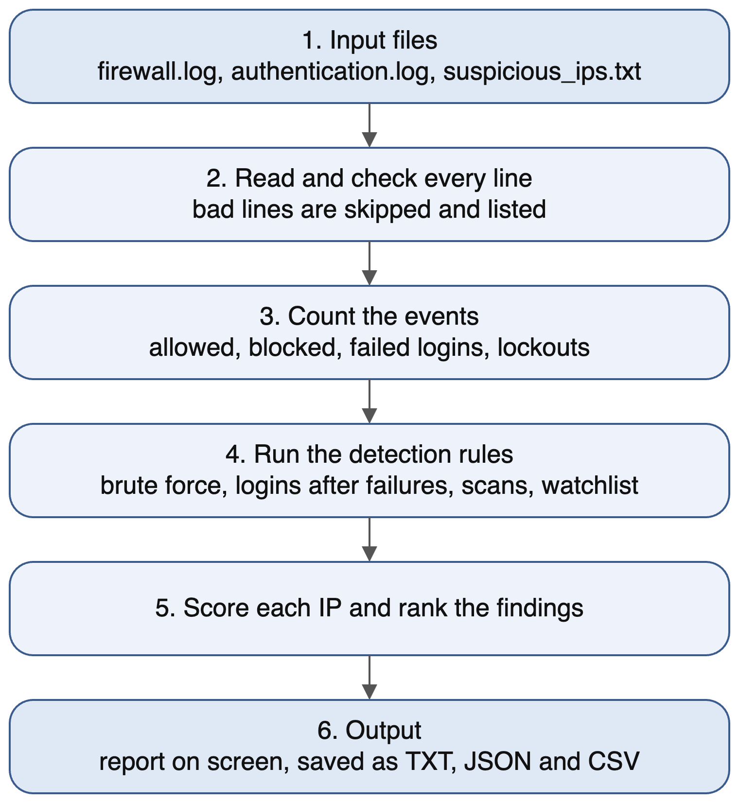

# Log Investigator

A Python command-line tool that reads a firewall log and a login log, throws out the broken lines, and tells you which IP addresses look like attackers and whether any of them got in.

Built by HKM Fuyad Islam for COMP H2702 Scripting for Cybersecurity at TU Dublin (individual project, Scenario A: Security Log Investigation).



## What a run looks like

```text
[*] loading logs...
[+] firewall log: 892 valid events, 7 skipped
[+] authentication log: 514 valid events, 5 skipped
[*] analysing...

[ RANKED FINDINGS ]
  #1  [HIGH] Login success after repeated failures - 203.0.113.77 (evidence: 17)
       17 failed logins then a success as admin on vpn01 at 2026-10-12 14:51:00.
  #2  [HIGH] Successful login from watchlisted IP - 198.51.100.18 (evidence: 1)
       svc_backup logged in to files01 with ssh_key at 2026-10-12 08:12:20.
  #3  [HIGH] Brute-force login attempts - 198.51.100.23 (evidence: 46)
       Up to 16 failures inside 30 min, 46 in total, against admin, administrator, root, svc_backup.
```

That is cut down. The full report is in [`sample_output/investigation_report.txt`](sample_output/investigation_report.txt).

## What you need

- Python 3.8 or newer
- Nothing else. The tool only uses the standard library (`argparse`, `collections`, `csv`, `datetime`, `ipaddress`, `json`, `unittest`).

`requirements.txt` is in the repo but has no packages in it, so `pip install -r requirements.txt` does nothing and that is expected.

Check your Python version:

```bash
python3 --version
```

On Windows the command is usually `python` or `py` instead of `python3`. Every command below uses `python3`, so swap it if you are on Windows.

## Getting it

```bash
git clone https://github.com/fuyadislam/log-investigator.git
cd log-investigator
```

Or click the green **Code** button on this page, choose **Download ZIP**, unzip it, and open a terminal in that folder.

## Running it

### The normal run

```bash
python3 log_investigator.py
```

With no options it reads the three files in `data/`, prints the report in the terminal, and saves four files in a folder called `output/` (it makes the folder if it isn't there).

### See every option

```bash
python3 log_investigator.py --help
```

| Option | Default | What it changes |
| --- | --- | --- |
| `--firewall` | `data/firewall.log` | Which firewall log to read |
| `--auth` | `data/authentication.log` | Which login log to read |
| `--watchlist` | `data/suspicious_ips.txt` | The list of suspicious IPs. Optional, the tool still runs without it |
| `--output` | `output` | Folder the reports are saved in |
| `--top` | `5` | How many rows go in each "top" list |
| `--brute-force` | `10` | How many failed logins inside the time window count as brute force |
| `--window` | `30` | The brute force time window, in minutes |

### Examples

Stricter brute force rule (5 failures in 10 minutes):

```bash
python3 log_investigator.py --brute-force 5 --window 10
```

Show the top 3 instead of the top 5 in every list:

```bash
python3 log_investigator.py --top 3
```

Run it on your own logs and save the results somewhere else:

```bash
python3 log_investigator.py --firewall my_logs/fw.log --auth my_logs/auth.log --output results
```

Run it without a watchlist:

```bash
python3 log_investigator.py --watchlist none.txt
```

You'll get `[!] watchlist not found (none.txt), carrying on without it` and the rest of the report still runs. The watchlist findings are left out.

### Open the results

```bash
ls output
open output/findings.csv
```

`open` is the macOS command. On Windows use `start output\findings.csv`, on Linux `xdg-open output/findings.csv`.

## Input files

The files in `data/` are the synthetic dataset supplied with the module. The public-looking IPs are from the documentation ranges (192.0.2.0/24, 198.51.100.0/24, 203.0.113.0/24), so they are just text. The tool never connects to any of them.

| File | Line format |
| --- | --- |
| `firewall.log` | `timestamp ACTION src=<ip> dst=<ip> proto=<TCP/UDP> port=<n> bytes=<n>` |
| `authentication.log` | `timestamp EVENT user=<name> src=<ip> host=<host> method=<method>` |
| `suspicious_ips.txt` | one IP per line, lines starting with `#` are skipped |

If you use your own logs they need to follow the same format. Lines that don't are skipped and listed, not guessed.

## Output files

| File | What's in it |
| --- | --- |
| `investigation_report.txt` | Exactly what was printed in the terminal |
| `investigation_report.json` | Every count, finding and score, for loading into another tool |
| `findings.csv` | The ranked findings, one per row. Opens in Excel or Numbers |
| `ip_risk.csv` | Every source IP with its score and risk level |

## The report, section by section

1. **Data quality.** Every line that was skipped, with its line number and the reason (empty `src=`, `port=notaport`, unknown action, missing timestamp and so on). This comes first so you know how much of the data was actually used.
2. **Firewall summary.** Valid events, ALLOWED vs BLOCKED, unique source IPs, top blocked IPs, most targeted ports.
3. **Authentication summary.** LOGIN_SUCCESS, LOGIN_FAILED, ACCOUNT_LOCKED and LOGOUT counts, top failed-login IPs, most targeted usernames.
4. **Ranked findings.** What the detection rules found, worst first, each with a short explanation.
5. **Top risk IPs.** Each IP's score, level and the numbers behind it.

## How it decides what's suspicious

| Finding | Rule | Severity |
| --- | --- | --- |
| Login success after repeated failures | 3+ failures then a success from the same IP within 60 min | HIGH |
| Successful login from a watchlisted IP | any LOGIN_SUCCESS from an IP in the watchlist | HIGH |
| Brute force | 10+ failures from one IP inside 30 min | HIGH |
| IP seen in both logs | outside IP with blocked traffic and failed logins, 10+ events | MEDIUM |
| Account locked out | any ACCOUNT_LOCKED | MEDIUM |
| Many usernames from one IP | 3+ different users and 10+ failures | MEDIUM |
| Possible port scan | one IP blocked on 10+ different ports | MEDIUM |
| Watchlisted IP allowed through | ALLOWED firewall traffic from a watchlisted IP | MEDIUM |
| Blocked on admin or database ports | outside IP blocked on 22, 23, 445, 3306, 3389 or 5432 | LOW |
| Watchlisted IP not seen | in the watchlist but in neither log | LOW |

The risk score adds points per IP: 1 per blocked connection, 2 per failed login, 5 per lockout, 10 for being on the watchlist, 10 for showing up in both logs, 20 for a success after failures, 25 for a successful login from a watchlisted IP. 60 or more is HIGH, 25 or more is MEDIUM, anything below is LOW.

These numbers were set after looking at the dataset. Lower settings flagged dozens of normal internal machines that had two or three typos, so they were raised until the findings were things worth checking. They all live in the `SETTINGS` dictionary at the top of `analysis.py` if you want to change them.

## When something goes wrong

These are handled with a clear message instead of a Python traceback:

```bash
python3 log_investigator.py --auth missing.log
# [ERROR] authentication log not found: missing.log

python3 log_investigator.py --top 0
# [ERROR] --top has to be 1 or more

python3 log_investigator.py --firewall data
# [ERROR] firewall log path is a folder, not a file: data
```

Also covered:

- A log with no valid lines at all stops the run and says how many lines were bad.
- No permission to read a file gives an error message, not a crash.
- Strange bytes in a file are replaced while reading, so the read doesn't fail.
- If the output folder can't be written to, the tool says so. The report is already on screen by then.
- Ctrl+C stops it cleanly.

## Tests

```bash
python3 -m unittest discover tests -v
```

Six tests. Three feed the parsers the same kinds of broken lines that are in the dataset and check they're rejected. Three check the detection rules: brute force is caught, slow failures spread over hours are not counted as brute force, and a success after failures is flagged.

## Files

```text
log_investigator.py   starts everything: options, error messages, calls the other files
parsers.py            reads the logs and checks every field on every line
analysis.py           counting, detection rules, risk scores, ranked findings
report.py             builds the text report and writes the TXT, JSON and CSV files
tests/                unit tests
data/                 the supplied dataset
sample_output/        the four report files from a full run
docs/                 workflow diagram
```

## Limits

- The thresholds suit this dataset. Real logs would need them tuned again.
- A slow attacker who stays under 10 failures in 30 minutes, or one inside the network, can be missed.
- A success after failures might just be someone who forgot their password. The tool flags it; a person still has to check.
- The watchlist is only as good as whoever wrote it. An IP not being on it doesn't make it safe.
- It only reads these two log formats.

## Where AI came in

I built this with help from Claude (Anthropic), which I used for writing the code and this README. I ran every command here on my own MacBook and checked the findings against the raw log lines before submitting. I can walk through any part of it.
